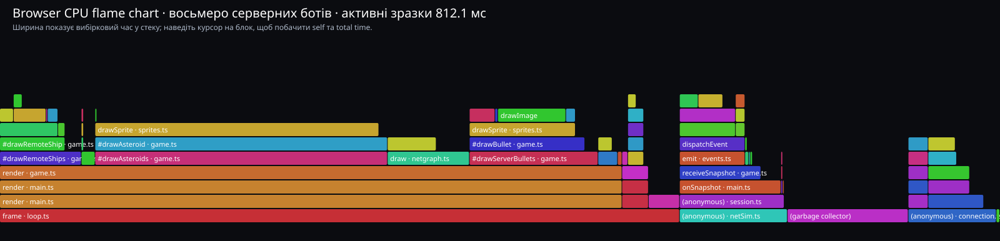
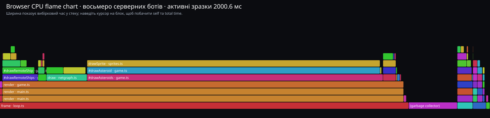
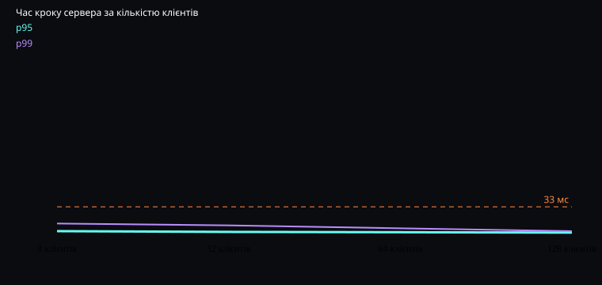

# Лабораторна робота 4

У цій роботі до браузерної гри додано сервер на Node.js. Він створює кімнати, підключає гравців, передає повідомлення чату та зберігає події матчу.

## Що робить сервер

- Віддає зібрану гру та відповідає на запити про стан сервера і список кімнат.
- Дозволяє створювати кімнати. Коли всі гравці виходять, кімната видаляється.
- Використовує WebSocket для входу до кімнати, списку гравців і чату.
- Перевіряє повідомлення, обмежує їхній розмір і частоту та відключає клієнтів, які перестали відповідати.
- Записує події матчу у файл частинами. Replay теж передається частинами, тому весь великий файл не завантажується у пам'ять одразу.
- Коректно закриває з'єднання та дописує журнали під час зупинки сервера.

Кімнати використовують EventEmitter, вбудований у Node.js механізм повідомлення про події. Якщо обробник HTTP блокує сервер на 300 мілісекунд, інші запити, повідомлення та таймери цього сервера теж чекають. Якщо помилку EventEmitter не обробити, процес сервера може аварійно завершитися.

## Перевірка потокової передачі

Для перевірки створюється файл розміром 200 мегабайт і передається повільному клієнту. У цьому запуску передача тривала 87,2 секунди. Пам'ять сервера зросла з 48,4 до 63,7 мегабайта, а не на весь розмір файла.

```sh
npm run bench:rss
```

## Лабораторна робота 5

У цій лабораторній сервер став головним для гри. Браузер надсилає натиснуті кнопки, а сервер сам рахує рух, постріли, самонавідні астероїди, аптечки, зіткнення і життя кораблів. Якщо клієнт надішле координати, сервер їх не прийме.

### Як запустити

Відкрий два термінали у папці проєкту `lab-01-game`.

У першому запусти сервер:

```sh
npm run dev:server
```

У другому запусти сторінку гри:

```sh
npm run dev:client
```

Відкрий `http://localhost:5173` у двох вікнах браузера. У лобі без позначки «Серверний режим гри» запускається гра з лабораторної 4. Щоб перевірити лабораторну 5, увімкни цю позначку в обох вікнах, увійди в одну кімнату під різними іменами. Керування: стрілки рухають корабель, пробіл стріляє. На панелі ліворуч видно мережеві показники.

### Передбачення і затримка

Клієнт надсилає пакет із номером `seq` та кнопками газу, повороту й пострілу. У пакеті немає позиції корабля. Сервер рахує гру з частотою 30 кроків за секунду. Кожен наступний крок планується на цільовий час через `setTimeout`, а не через `setInterval`.

Після входу корабель і перший знімок світу беруться з сервера. У знімку вже є кораблі та п'ять астероїдів, тому їх видно відразу після приєднання. Коли передбачення ввімкнене, клієнт одразу застосовує ті самі правила фізики до свого корабля. У знімку сервер повідомляє останній оброблений `seq`. Клієнт прибирає підтверджені натискання, ставить стан із сервера і повторно застосовує решту черги. Різниця згладжується приблизно за 100 мілісекунд.

Інші кораблі малюються за знімками приблизно на 100 мілісекунд у минулому. Це дає змогу інтерполювати положення між двома знімками. Власна куля з'являється одразу; після відповіді сервера її замінює серверний стан.

У лобі можна змінити затримку, розкид і втрату пакетів. Початкові значення для досліду: 100 мілісекунд затримки в кожному напрямку, розкид до 20 мілісекунд, втрата 0 відсотків. За таких налаштувань RTT має бути близько 200 мілісекунд; точне значення видно на netgraph. Перемикач передбачення можна вимкнути, щоб показати, як корабель чекає на знімок.

### JSON і бінарний пакет

У лобі можна вибрати JSON або бінарний формат. Клієнти можуть грати в одній кімнаті, навіть якщо вибрали різні формати. Я порівняла знімок із двома кораблями, однією кулею, п'ятьма астероїдами й аптечкою. У JSON він займав 978 байтів, а в бінарному форматі — 433 байти. Вийшло на 545 байтів менше, приблизно на 56 відсотків. У бінарному пакеті є байт версії та типу, числа записані в little-endian, а кут корабля зберігається як `Int16`. JSON я залишила в грі, щоб можна було повторити порівняння.

### Детермінізм і чесність гри

`shared/engine.ts` використовується і браузером, і Node.js. Функція `integrate` отримує стан, кнопки й фіксований `dt`, а повертає новий стан. У ній немає `Math.random()` або `Date.now()`. Стартові позиції створює серверний генератор із seed кімнати.

Під час досліду я тимчасово додала до фізики випадкове відхилення до половини пікселя за крок і потім прибрала його. В одному запуску після 300 кроків поправка сягнула 7,35 пікселя, а наприкінці становила 5,38 пікселя. Причина в тому, що клієнт і сервер отримали різні випадкові числа. У фінальній `integrate` випадковості немає.

Це не повна система захисту від читів, але клієнт не може сказати серверу «постав мене в точку X/Y». Він може надіслати тільки дозволений input із послідовністю. Сервер перевіряє формат і частоту повідомлень, сам змінює стан і розсилає знімки.

### Перевірка двох клієнтів

Локальна перевірка двох WebSocket-клієнтів пройшла в одній кімнаті: кожен отримав 49 знімків за 1,7 секунди, у кожному знімку було два кораблі, обидва рухалися. Перевірено окремо бінарний і JSON формати.

### Де показати це в коді

- У [`shared/engine.ts`](shared/engine.ts) знайди `integrate`. Вона отримує стан корабля й кнопки, а повертає новий стан після одного кроку фізики.
- У [`server/src/rooms.ts`](server/src/rooms.ts) знайди `queueInput`, `startSimulation` і `#stepSimulation`. Тут сервер приймає кнопки, планує кроки 30 разів за секунду й сам рухає кораблі.
- У [`server/src/wsServer.ts`](server/src/wsServer.ts) знайди обробку `isBinary` і повідомлення `input`. Тут сервер перевіряє формат і не приймає координати від клієнта.
- У [`shared/protocol.ts`](shared/protocol.ts) знайди `serializeInput`, `deserializeInput`, `serializeSnapshot` і `deserializeSnapshot`. Тут `DataView` перетворює input та знімки на байти й назад.
- У [`client/src/net/game.ts`](client/src/net/game.ts) знайди `update` і `receiveSnapshot`. Перша функція передбачає рух, друга звіряє його зі станом сервера та повторює ще не підтверджені input.
- У тому самому файлі знайди `#drawRemoteShips` і `#interpolationPair`. Вони показують інших гравців за двома знімками з затримкою.
- У [`client/src/netSim.ts`](client/src/netSim.ts) задаються затримка, розкид і втрата. У [`client/src/netgraph.ts`](client/src/netgraph.ts) малюються RTT, вік знімка, байти, черга input і поправка.

GIF двох вікон ще потрібно записати під час демонстрації. Для нього відкрий гру у двох вікнах, зайди в одну кімнату, увімкни netgraph і запиши кілька секунд руху та стрільби. Збережи GIF у `client/docs/lab5-two-windows.gif`.

## Лабораторна робота 6

У цій роботі спільні правила гри, мережеві повідомлення та серверні модулі переведені на TypeScript. Браузер і сервер далі використовують один код симуляції з папки `shared`. Canvas і цикл гри залишилися без фреймворку, щоб не змінювати вигляд і керування попередньої лабораторної.

Запусти перевірку типів командою `npm run typecheck`. Та сама команда запускається у GitHub Actions після push і під час перевірки pull request. Для перевірки поведінки є команда `npm test`. Вона містить тест, який двічі програє однакові 600 команд і порівнює результат симуляції.

TypeScript допоміг знайти кілька помилок ще до запуску гри. Номер повороту спочатку виводився як будь-яке число, хоча протокол дозволяє тільки `-1`, `0` або `1`. Пошук у `Map` може не знайти кімнату, тому результат треба перевірити перед використанням. Елемент масиву астероїдів за індексом також може бути відсутній. Ще типи показали, що стан корабля без `kind` не є повним мережевим об'єктом корабля.

`EntityId`, `Tick` і `Seq` — це branded-типи. Усі вони зберігаються як рядки або числа, але TypeScript не дозволяє випадково передати номер кроку замість номера команди. `SnapshotEntity` — об'єднання корабля, кулі, астероїда й аптечки; поле `kind` підказує програмі, з яким саме об'єктом вона працює. `SnapshotCodec<Encoded>` — generic: він описує однаковий спосіб роботи для JSON-рядка та бінарного буфера.

Дані з мережі все одно перевіряються під час виконання. `parseClientMessage` приймає `unknown`, а Zod перевіряє форму й межі значень. Якщо JSON зіпсований або містить невідомий тип, сервер записує причину та закриває сокет. Бінарний декодер також перевіряє версію пакета, довжину та діапазони чисел. Типи самі по собі не захищають мережу: браузер може надіслати будь-які байти.

Для цієї гри залишено звичайний Canvas без Svelte, Vue чи React. У грі вже є власний Canvas-рендер і невеликий HUD. Додавання фреймворку не допомагає симуляції, протоколу або малюванню, а змінило б структуру попередніх лабораторних.

Основний код лабораторної 6 знаходиться тут:

- `shared/types.ts` містить незмінні типи стану, сутностей і branded-значення.
- `shared/engine.ts` містить спільну фізику для браузера та Node.js.
- `shared/protocol.ts` містить Zod-схеми, перевірку повідомлень і JSON та бінарне кодування.
- `server/src/config.ts` перевіряє змінні середовища через Zod.
- `server/src/rooms.ts` містить типізовані події кімнати й серверну симуляцію.
- `server/src/wsServer.ts` перевіряє мережеві дані до їх використання.
- `client/src/net/connection.ts` перевіряє повідомлення сервера й маршрутизує їх до типізованих слухачів.
- `client/src/net/game.ts` містить передбачення корабля та звірку зі знімками.

Команди лабораторної:

```sh
npm run typecheck
npm test
npm run build
```

## Лабораторна робота 7

[](https://github.com/8174150-MN/lab-01-game/actions/workflows/lab-07.yml)

У цій лабораторній я додала тести для спільної фізики, протоколу, сервера та клієнта, а також сценарії з ботами й двома браузерами. Тепер однакові input-команди перевіряються на повторюваність, а клієнт і сервер використовують той самий код симуляції.

### Що перевіряє TypeScript і тести

Сутності мають поле `kind`, тому TypeScript розрізняє корабель, кулю, астероїд і бонус. У розгалуженнях за `type` та `kind` використовується `never`: якщо додати новий вид повідомлення чи сутності й забути його обробити, перевірка типів зупиниться. ID, номер кроку й номер input мають окремі branded-типи, тож їх не можна випадково поміняти місцями. Мережеві дані починають шлях як `unknown` і проходять Zod-перевірку до використання. `any` не використовується.

Тести перевіряють, що однакова послідовність input дає однаковий стан, вектор і фізика не змінюють вхідні об'єкти, корабель лишається в арені, колізії повертають правильні пари, а двійковий декодер відхиляє короткий або пошкоджений пакет. П'ять властивостей `fast-check` генерують багато значень для перевірки: binary round-trip з округленням кута, точна довжина кадру, контрольована помилка на битому буфері, межі координат у арені та прийняття/відхилення повідомлень схемою.

Звірка передбачення винесена у чисту функцію `reconcilePrediction`: вона бере стан сервера й непідтверджені input та повертає новий стан. Окремі тести перевіряють цей результат. Фіктивний час тестує fixed-step loop і heartbeat: якщо два pong поспіль пропущено, сервер від'єднує клієнта.

У цьому запуску пройшли всі 154 unit-тести. У `shared` — 62 тести, покриття рядків 98,7%, гілок 92,53% і функцій 100%. У `client` пройшли 83 тести, у `server` — 9.

Playwright запускає три браузерні сценарії: серверний бот рухається й з'являється у списку гравців; два браузери бачать рух один одного не пізніше ніж за 500 мс, отримують чат і бачать серверну кулю після пострілу; дослід порівнює обчислення input для ботів у головному потоці й Worker. У цьому прогоні всі три сценарії пройшли. Серверний тест окремо перевіряє, що повтори однакового руху не накопичуються, а постріл не губиться в черзі. Перевірка рядків `shared` вище — це 98,7%; поріг лабораторної становить 85%.

GitHub Actions запускає `typecheck`, ESLint, unit-тести, покриття, production-збірку й Playwright на кожному push та pull request. Бейдж угорі показує стан цього workflow після завантаження змін у GitHub.

### V8 і виділення пам'яті

Коли JavaScript уперше виконує функцію, V8 перетворює її у байткод для інтерпретатора Ignition. Гарячі функції можуть перейти в оптимізований код JIT-компілятора. Якщо пізніше типи значень не відповідають припущенням компілятора, V8 робить deoptimization і повертається до менш оптимізованого виконання. Однорідна форма об'єктів допомагає V8 повторно використовувати hidden classes та inline caches.

Невикористані об'єкти прибирає garbage collector. Короткоживучі об'єкти часто очищаються молодим поколінням GC; більша пауза може статися, коли V8 збирає старе покоління. Кулі й частинки беруться з пулу, вектори симуляції та стани рендеру перевикористовуються, рендер не створює тимчасові `Map`, `Set` і масиви для кожного кадру. Історія знімків обмежена вісьмома станами. Мережевий HUD оновлює текст чотири рази на секунду й повторно малює кешовану панель між оновленнями.

У реальному 30-секундному профілі з вісьмома ботами V8 записав flame chart і вибіркові стеки алокацій. Найбільші вибіркові алокатори у цьому запуску — `NetGraph.draw` (114 704 байти) та `recordFrame` (32 772 байти). Це приблизна вибірка семплера, не повний облік усіх створених байтів. У CPU-профілі серед гарячих браузерних викликів були `drawImage` (59,5 мс), callback мережевого з'єднання (53,34 мс) і `setTimeout` (46,51 мс).

Порівняла два 30-секундні запуски. До оптимізації було 1761 кадр: p50 — 16,6 мс, p95 — 17,7 мс, p99 — 19,9 мс. Сталося 24 події GC, з них дві великі; сумарна пауза становила 109,02 мс, найдовша — 57,20 мс.

Після змін було 1712 кадрів: p50 — 16,6 мс, p95 — 18,0 мс, p99 — 20,0 мс. Сталося 18 подій GC, з них одна велика; сумарна пауза становила 91,27 мс, найдовша — 72,37 мс.

Кількість і загальний час GC стали меншими, але найдовша окрема пауза стала більшою. Час кадру p99 у цьому вимірі не покращився, тож ціль методички — p99 менше 16,7 мс і відсутність довгих GC-пауз — не досягнута. Зміни рендеру й пулів зменшують зайву роботу, але цей ноутбук не показав потрібний результат; під час попередньої перевірки диспетчер задач показував 100% CPU та 93% пам'яті. На результат також впливають браузер, інші відкриті програми й фонові процеси. Я записала фактичні числа, а не позначила ціль як виконану.

Окремий повтор після змін без DevTools профайлера дав p50 17,8 мс, p95 19,2 мс і p99 31,1 мс. Це повільніше за інструментований вимір і показує, що одне 30-секундне вікно сильно залежить від стану комп'ютера. Його результат збережений у `server/bench/browser-profile-metrics-only.json`.

До і після можна переглянути у [flame chart до](server/bench/browser-profile-before-flame.svg) та [flame chart після](server/bench/browser-profile-flame.svg). Сирі DevTools профілі й звіти лежать у `server/bench/browser-profile-before.cpuprofile`, `server/bench/browser-profile.cpuprofile`, `server/bench/browser-allocations-before.heapprofile`, `server/bench/browser-allocations.heapprofile`, а короткий список алокаторів — у `browser-allocators-before.json` та `browser-allocators.json`.





### Web Worker

Сторінка `client/worker-benchmark.html` рахує input восьми ботів двома способами. У одному запуску головний потік затримав таймер на 39,3 мс, Worker — на 2,2 мс. Сам розрахунок із передаванням результату зайняв 32,3 мс на головному потоці та 179,8 мс разом із запуском Worker і передаванням буфера. Worker залишився окремим дослідом: він краще відгукнувся для інтерфейсу в цьому вимірі, але загальна робота була повільнішою, тому в ігровий цикл його не перенесено.

### Навантаження сервера

`npm run bench:load` запускає WebSocket-клієнтів без браузерних вікон на рівнях 8, 32, 64 і 128. Кожен надсилає ті самі binary input-команди, що й гра. Вимірювання триває 2,5 секунди на рівень, його можна подовжити параметром `--duration=60000`. Для окремого 60-секундного запуску восьми клієнтів: спочатку запусти сервер із `npm run dev:server`, а потім виконай `npm run bench:load -- --clients=8 --duration=60000`.

У короткому навантажувальному запуску з 8 клієнтами p99 кроку був 11,74 мс, найдовший крок — 11,74 мс, кроків понад 33 мс не було, максимальна пам'ять RSS — 60,0 МБ. З 32 клієнтами p99 становив 9,39 мс, найдовший крок — 13,76 мс, кроків понад 33 мс не було, RSS — 64,2 МБ.

З 64 клієнтами p99 був 5,67 мс, але один крок тривав 247,29 мс; RSS — 72,2 МБ. З 128 клієнтами p99 був 2,01 мс, один крок тривав 64,96 мс, а RSS сягнув 85,0 МБ. Отже, показник p99 сам по собі приховує рідкі довгі затримки: перша затримка понад 33 мс з'явилася на 64 клієнтах.

За цим коротким тестом орієнтир для ноутбука — до 32 одночасних клієнтів. На 64 та 128 клієнтах цикл Node був повністю зайнятий і знімки приходили із запізненням. Це результат конкретного комп'ютера, а не універсальний ліміт гри. Графік: [навантаження 8, 32, 64 і 128 клієнтів](server/bench/load-results.svg).



Окремий 60-секундний тест восьми клієнтів дав p99 кроку 0,93 мс, максимум 1,95 мс, 0 кроків понад 33 мс, RSS зріс із 67,7 до 84,6 МБ, p95 часу між знімками — 69,49 мс. CPU-профіль сервера записаний у [server-profile-8-clients.cpuprofile](server/bench/server-profile-8-clients.cpuprofile), його flame chart — [server-profile-8-clients-flame.svg](server/bench/server-profile-8-clients-flame.svg). Серед найбільших вузлів профілю — кодування та читання/запис мережевих кадрів; повний список функцій є в `server-profile-8-clients-hot-functions.json`.

### Як повторити

Запусти повний набір перевірок командами `npm run typecheck`, `npm run lint`, `npm run format:check`, `npm test`, `npm run coverage:shared`, `npm run build` і `npm run test:e2e`. Playwright сам запускає окремі тестові сервер і Vite на портах 3107 та 4177.

Браузерний профіль до або після записується командою `npm run bench:profile`. Для заміру до зміни в PowerShell спочатку задай `$env:LAB7_PROFILE_MODE='before'`; для звичайного виміру після оптимізації параметр прибери. На цьому ноутбуці для Edge можна задати `$env:PLAYWRIGHT_CHANNEL='msedge'`. Серверний CPU-профіль триває стільки, скільки в `LAB7_PROFILE_DURATION_MS`; приклад у PowerShell: `$env:LAB7_PROFILE_DURATION_MS='75000'`, `$env:PORT='3207'`, `$env:LOG_DIR='server/bench/server-profile-logs'`, `npm run bench:server-profile`, а в іншому терміналі — 60-секундний запуск восьми клієнтів із командою вище.

### Що показати на захисті

Відкрий гру у двох браузерах, зайди в одну кімнату, порухай корабель і надішли повідомлення чату. Потім відкрий тест `shared/test/engine.vitest.ts`, де перевіряється детермінізм фізики або звірка передбачення; покажи короткий випадок, який `fast-check` генерує сам. Наприкінці покажи один flame chart і поясни: V8 спочатку виконує байткод, оптимізує гарячі функції, а GC прибирає непотрібні об'єкти.

## Лабораторна робота 8

[](https://github.com/8174150-MN/lab-01-game/actions/workflows/lab-08-production.yml)

У цій роботі я підготувала гру до запуску в Docker і на хостингу. Браузер завантажує сторінку та малює гру. Через WebSocket він надсилає серверу кнопки керування. Сервер рахує світ і повертає знімки. Спільні правила симуляції залишилися в `shared`, тому сервер і браузер рахують однаково.

### Що вже підготовлено

Сервер читає порт, дозволені адреси сайтів і ліміти з оточення. `server/src/config.ts` перевіряє їх через Zod. У `server/src/wsServer.ts` сервер звіряє `Origin` перед WebSocket-з'єднанням, рахує відкриті з'єднання з IP і відхиляє зайві. За проксі адресу з `X-Forwarded-For` він читає лише тоді, коли `TRUST_PROXY=true`.

`/health` показує, що процес працює, та повертає версію і git SHA збірки. `/ready` відповідає успішно тільки після готовності сервера приймати гравців. `/metrics` показує кількість гравців і кімнат, повідомлення та байти за секунду, час кроку гри, зайнятість event loop, використану пам'ять і кількість відхилених з'єднань.

`server/src/appLogger.ts` налаштовує Pino. Сервер пише JSON-рядки в stdout із часом, версією, SHA, ID кімнати та ID гравця; текст чату й паролі в журнал не записуються. Невідома помилка потрапляє в журнал і завершує процес з помилкою, щоб хостинг міг його перезапустити.

Під час `SIGTERM` сервер перестає приймати нових гравців, надсилає клієнтам повідомлення про зупинку, закриває WebSocket кодом 1001, дописує журнали та завершується з кодом 0. Клієнт повертається до лобі. Для цієї перевірки є `scripts/docker-stop-check.mjs`; він працює у Linux Docker workflow.

`Dockerfile` має окремий етап збірки й фінальний етап. У фінальний образ потрапляють зібраний клієнт, скомпільований сервер і потрібні для запуску пакети. Процес працює від користувача `node`, а команда запуску напряму викликає Node. Docker перевіряє `/health`. `docker-compose.yml` задає порт, журнал і десятисекундний час на зупинку.

Для телефону додані manifest і service worker. У manifest є значки 192×192 і 512×512, а worker кешує сторінку, зібраний код, спрайти й звуки. Мережеві маршрути не кешуються. Коли сторінка відкрита через HTTPS, клієнт використовує `wss://`; на локальному HTTP використовує звичайний `ws://`.

### Як перевірити локально

У корені проєкту виконай:

```sh
npm ci
npm run typecheck
npm run lint
npm run format:check
npm test
npm run coverage:shared
npm run build
npm run production:smoke
npm run chaos:check
npm run test:e2e
```

Щоб запустити production-подібний варіант у Docker, скопіюй `.env.example` у `.env`, потім виконай `docker compose up --build` і відкрий `http://localhost:3000`. Команди `docker compose ps` і `docker compose logs -f game` показують стан контейнера й журнал.

Локальні smoke-перевірки перевіряють `/health`, `/ready`, `/metrics`, PWA-файли, відхилення чужого `Origin`, обмеження з'єднань з однієї IP та структурований журнал входу. `npm run chaos:check` відкриває дві кімнати, від'єднує одного клієнта й надсилає тисячу некоректних кадрів іншому. Сервер закриває атакувальний сокет після першого кадру й ігнорує вже поставлені в чергу кадри. У останньому запуску здоровий гравець отримав 36 знімків, а p99 часу кроку у його кімнаті змінився з 3,397 мс до 4,267 мс — у межах допуску цього тесту. Playwright запускає сценарій гри у двох браузерах.

Docker на моєму ноутбуці не встановлений, тому перевірку контейнера виконує GitHub Actions на Linux. Останній успішний запуск перевірив образ розміром менше 200 МБ, готовність сервера, WebSocket і зупинку контейнера з кодом 0 менш ніж за 10 секунд. Посилання на запуск є на початку цього README.

### Заміри з попередніх робіт

У порівнянні з лабораторної 5 знімок із двома кораблями, кулею, п'ятьма астероїдами й аптечкою займав 978 байтів у JSON і 433 байти у бінарному форматі. Бінарний знімок був меншим на 545 байтів, приблизно на 56 відсотків.

У 30-секундному профілі з лабораторної 7 до змін кадр p50 займав 16,6 мс, p95 — 17,7 мс, p99 — 19,9 мс. Після змін це було 16,6 мс, 18,0 мс і 20,0 мс. Отже, ціль p99 менше 16,7 мс на цьому ноутбуці не досягнута. У короткому серверному тесті перший крок довший за 33 мс з'явився на 64 клієнтах; до 32 клієнтів кроки вкладалися в цей ліміт. Це замір саме цього комп'ютера, а не гарантія місткості хостингу.

Кімнати зберігаються в пам'яті одного процесу. Тому для цієї версії хостинг треба налаштувати на один екземпляр сервера. Якщо запустити кілька незалежних екземплярів без спільного сховища стану, гравці однієї кімнати можуть потрапити на різні процеси й не побачити один одного.

### Що потрібно для живої адреси

Живої адреси поки немає. Для неї підготовлений безкоштовний Render: файл `render.yaml` задає один екземпляр у Франкфурті, TLS, перевірку `/ready` і 10 секунд на завершення. Оскільки кімнати живуть у пам'яті процесу, один екземпляр потрібен, щоб гравці кімнати залишалися разом.

На безкоштовному тарифі Render зупиняє сервіс після 15 хвилин без відвідувачів; перше відкриття після паузи може чекати приблизно хвилину. Безкоштовний сервіс не має постійного диска, тому файли повторів у контейнері можуть зникнути після перезапуску. Для навчального демо це прийнятно, але це обмеження треба згадати на захисті. ([Умови безкоштовного тарифу Render](https://render.com/docs/free), [WebSocket на Render](https://render.com/docs/websocket))

Після успішної перевірки гілки GitHub Actions публікує тестовий образ `ghcr.io/8174150-mn/lab-01-game:lab-08-preview`. Перед створенням сервісу Render треба дати право читати цей приватний образ. Створи в GitHub особистий токен з дозволом `read:packages`. У Render відкрий Workspace Settings, Container Registry Credentials і додай GHCR-облікові дані з назвою `github-packages`. Токен вводиться тільки у Render і не надсилається в чат та не записується в репозиторій. ([Render про приватні образи GHCR](https://render.com/docs/deploying-an-image))

Потім у Render обери створення Blueprint, під'єднай цей GitHub-репозиторій і гілку `lab-07-v8-testing`. Render прочитає `render.yaml` і створить сервіс з образом, який уже перевірили в CI. Якщо назва сервісу зайнята, її можна змінити в цьому файлі перед створенням.

Після першого запуску скопіюй адресу сервісу, наприклад `https://назва.onrender.com`. У Settings репозиторію GitHub відкрий Secrets and variables, потім Actions, і створи два секрети. `DEPLOY_HOOK_URL` — секретне посилання Deploy Hook з налаштувань Render. `PUBLIC_BASE_URL` — публічна HTTPS-адреса гри. Сервер сам додає адресу Render до списку дозволених WebSocket Origin. Не публікуй значення Deploy Hook чи токена.

Після цього тег `v1.0.0` запускає релізний workflow: він збирає образ, публікує його в GHCR, просить Render розгорнути саме цей тег і перевіряє, що `/health` показує його SHA та версію. Тег `lab-08` позначить готову лабораторну. Теги ще не створені, бо спочатку треба мати живий сервіс і перевірити реліз.

Після розгортання треба відкрити гру за публічним посиланням на двох пристроях у різних мережах, перевірити чат і рух кораблів, переконатися, що WebSocket використовує `wss://`, і записати RTT. Ще не зроблені GIF та відео захисту на 3–5 хвилин; їх треба записати після перевірки живої гри.

### Що показати на захисті

Після публікації відкрий живу адресу у двох мережах, зайди в одну кімнату й покажи рух, чат і RTT. Потім відкрий `/metrics`, покажи перевірку `Origin` у `server/src/wsServer.ts`, а graceful shutdown — у `server/src/index.ts` та `scripts/docker-stop-check.mjs`. Поясни, чому кімната має залишатися в одному процесі та чому сервер приймає input, а не координати корабля.
